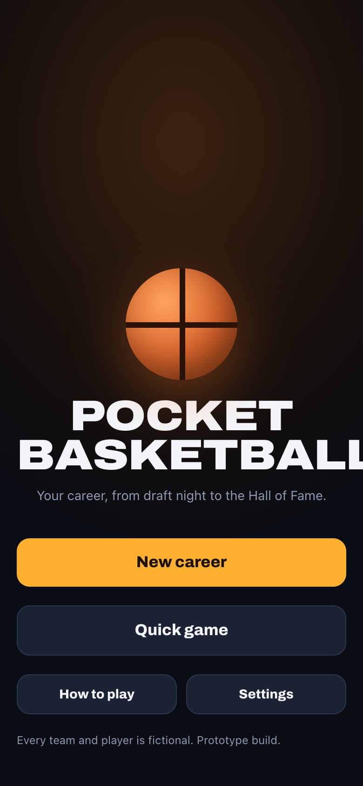

# PocketBasketball


**5-on-5 pro basketball for your phone, played upright, right in the browser.** Create one player and play a
career from draft night to the Hall of Fame. You control only yourself; your teammates and the other team play
around you, and a teammate grade follows every play.

<p>
  
  
  
</p>

**Play it:** https://eddyarriaga00.github.io/pocket-basketball/ (no install; add it to your home screen and it
plays offline too)

> Prototype. The design is in [docs/PLAN.md](docs/PLAN.md) and the order of work in [docs/ROADMAP.md](docs/ROADMAP.md).

## What's in the prototype

- **Career**: create a player (position, one of six builds, height, look, number), see every rating's ceiling,
  get drafted on draft night, then a season of games you play or sim. Skill points from your grade buy rating
  upgrades. Standings, news, a game log, season honors, the next season with aging.
- **On the floor**: 5-on-5 in a 3D arena. Computer teams space the floor, cut, drive and kick, play man defense
  with help, contest and box out. Shots are decided by the shooter's rating, the nearest defender and your
  release; blocks, fouls, and-ones, free throws, rebounds, steals, the shot clock and overtime are all in.
- **Teammate grade**: every bucket, assist, board, stop, forced shot and turnover moves it, live on the screen.
  After the game you see what moved it.
- **Quick game**: any two teams, any position.

## Controls

| | Touch | Keyboard |
|---|---|---|
| Move | Drag anywhere on the lower left (push to the edge to sprint) | WASD or arrows |
| Shoot / Jump | Big button: hold, let go at the top of the jump (the green band) | J or Space |
| Pass / Call / Steal | Middle button | K |
| Move (crossover) / Cut | Small button | L |
| Pause | ⏸ | P or Esc |

On defense, lift your thumb and your player stays in front of the man you guard on their own.

## The league

30 teams in the real league's cities with this game's own nicknames and colors. Every team and player is
fictional: real league, team and player names are trademarks.

## Run it locally

```
python3 tools/serve.py 8000
```
Then open http://localhost:8000. Tests: `node tools/smoke.js` and `node tools/balance.js` (they need Playwright).

## Built with

Plain JavaScript and three.js (r159, from cdnjs), no build step. Every model and texture is made in code.
