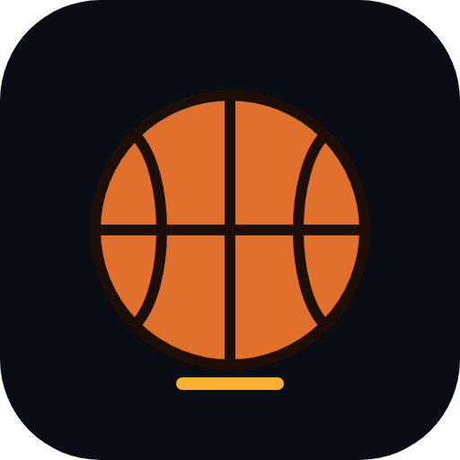
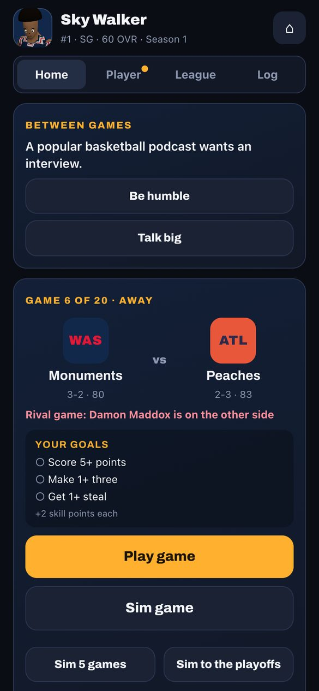
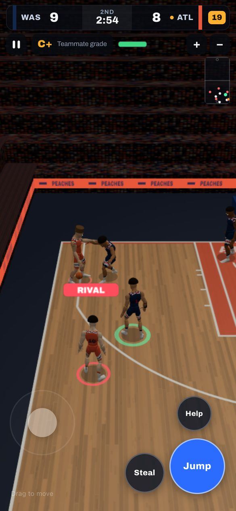

# PocketBasketball



**5-on-5 pro basketball for your phone, played upright, right in the browser.** Create one player and play a
career from the pre-draft combine to the Hall of Fame. You control only yourself; your teammates and the other team
play around you, and a teammate grade follows every play.

<p>
  
  
  
</p>

**Play it:** https://eddyarriaga00.github.io/pocket-basketball/ (no install; add it to your home screen and it
plays offline too)

The design is in [docs/PLAN.md](docs/PLAN.md), the order of work in [docs/ROADMAP.md](docs/ROADMAP.md), and what changed in [CHANGELOG.md](CHANGELOG.md).

## Career (the main mode)

- **Your player**: position, one of six builds, height, skin tone, number, and a Look card (hair, headband, arm
  sleeve, shoes). Every rating shows its ceiling from day one.
- **The road in**: a pre-draft combine (fifteen spot-up shots in 45 seconds, and your measurements) and team
  interviews that move your draft stock, draft night, and a rival from your draft class in your division.
- **The season**: play or sim each game. Three goals a game by position; team practice between games; a teammate
  grade that earns skill points; badges (bronze to gold, earned by doing the thing); coach trust that sets your
  role (starters start, a sixth man checks in mid-first quarter, the bench in the second); a word from the coach
  every five games; press conferences; a social feed and followers; shoe endorsements.
- **The league around you**: a real schedule with back-to-backs, injuries, trades and a rookie class every summer,
  Player of the Week, the All-Star fan vote, standings, league leaders, All-Star picks, the 3-Point Contest and the Dunk Contest, a play-in and
  playoff series, awards night (MVP, ROY, DPOY, Sixth Man, Most Improved, All-League, Finals MVP).
- **The business**: a rookie deal by pick, an extension offer, free agency with four offers, trade requests,
  career earnings; past thirty the legs slow, from 33 you can retire and the Hall of Fame votes.
- **Every summer**: training camp (one focus, with a drill for shooting and finishing).
- **Your legacy**: a record book of the device's best games and seasons, banners in the rafters for your titles and
  your retired jersey, a player card image to share, and your highlights after every game, saved as a video.
- **Saves**: up to six careers on a device, backups to a file you can open on another device.

## On the floor

- 5-on-5 in a 3D arena with rigged, animated players in team kits. Computer teams space the floor, run the
  pick-and-roll, cut, drive and kick, post up, throw alley-oops, help and recover on defense, switch screens and
  close out on shooters.
- Shots are decided by the shooter's rating, the nearest defender and your release (the meter). Dunks, layups,
  floaters, hooks, step-backs and euro steps; blocks, team fouls and the bonus, and-ones, free throws, charges,
  strips, rebounds, the shot clock and overtime. Computer games average about 114 points a team on 47% shooting,
  like the real league.
- The rules: eight seconds, backcourt, three seconds, goaltending, inbound plays, foul trouble.
- Call a pick, call a play (get me the ball, pick-and-roll, feed the post); get hot and they double you.
- Dribble moves on the Move button (swipe for a crossover either way, a step-back, a spin), stamina, replays of
  dunks and buzzer-beaters, an opening flyover, halftime stats, a shot chart and box score after the game.
- Three cameras: Player lock (the default: high behind your player, facing the rim in play), Broadcast (the
  sideline) and Overhead.
- Sound: a crowd that reacts to the home team (roars, groans, oohs, "DE-FENSE"), the arena organ, squeaks, the
  net, the rim, the whistle, the horn, a two-voice broadcast booth and an arena announcer (260 recorded lines), and
  players talking on the floor.
- Referees, benches and coaches, fans in the home colors, starting lineups before the tip.

Also: Season (one team, the whole team under your thumbs, to a title), Quick game (any two teams, one player or the
whole team), Practice (the 3-point and dunk contests, the drill, a shoot-around), Edit teams.

## Controls

| | Touch | Keyboard | Controller |
|---|---|---|---|
| Move | Drag anywhere on the lower left (push to the edge to sprint) | WASD or arrows | Left stick or d-pad |
| Shoot / Jump | Big button: hold, let go at the top of the jump (the green band) | J or Space | A |
| Pass / Call / Steal | Middle button | K | B |
| Crossover / Cut | Small button: tap, or swipe left or right | L | X |
| Step-back / Spin | Small button: swipe down / up | U / I | Y / right bumper |
| Call a pick | Pick (with the ball, over half court) | O | Left bumper |
| Pause | ⏸ | P or Esc | Start |

On defense, lift your thumb and your player stays in front of the man you guard on their own.

## The league

30 teams in the real league's cities with this game's own nicknames and colors. Every team and player is
fictional: real league, team and player names are trademarks. Settings › Edit teams renames any team on your device.

## Run it locally

```
python3 tools/serve.py 8000
```
Then open http://localhost:8000. Tests (they need Playwright): `node tools/smoke.js`, `node tools/balance.js`,
`node tools/drill.js`, `node tools/career.js`.

## Built with

Plain JavaScript and three.js (r159), no build step. The player body and its animations are Quaternius's
public-domain mannequin; the arena, kits, faces and basketball poses are made in code. Most sound is made in code;
a few effects are public-domain recordings, and the booth is recorded with Chatterbox from original synthetic
voices ([credits](docs/CREDITS.md)).
